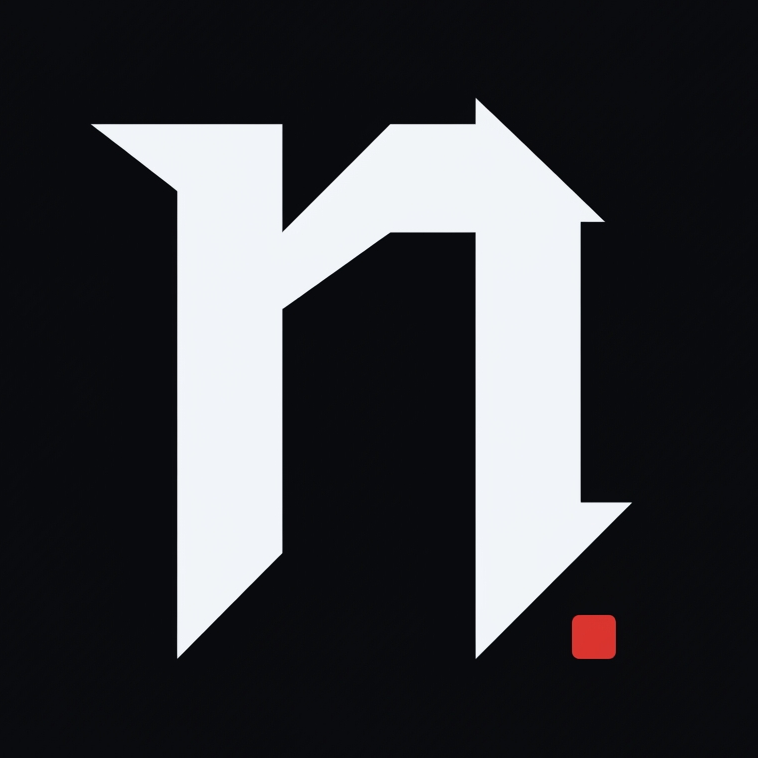

# Negai — Аниме и кино 4K видеоплеер для Android

<p align="center">
  
</p>

<p align="center">
  <a href="README.md">English</a> · <strong><a href="README.ru.md">Русский</a></strong>
</p>

<p align="center">
  
  
  
  
  
</p>

<p align="center">
  <a href="https://apps.obtainium.imranr.dev/redirect?r=obtainium://add/https://github.com/Poison5820/Negai">
    
  </a>
</p>

---

## О проекте

**Negai** — флагманский высокопроизводительный 4K-видеоплеер для Android, созданный для ценителей аниме, фильмов и сериалов. Плеер объединяет нативный графический видеоконвейер **Vulkan 1.1 (`SPIR-V`)** и **OpenGL ES 3.1 (`FP16`)**, апскейлеры **Anime4K** + **ArtCNN C4F16** + **AMD FSR 1.0** + **Qualcomm SGSR v1** и **16-битный Дебандинг**, **10-кадровый Lookahead MEMC** (**RIFE v4.22-lite** и **двунаправленный Optical Flow OpenCV DIS L5–L3**), мобильную **Адаптивную синхронизацию (`VRR / LFC`)**, естественный **4K HDR10 / Dolby Vision**, бинауральный звук **MIT KEMAR HRTF**, оптические темы **«Жидкое» и «Матовое стекло»**, поддержку **120+ языков мира** для автоподбора дорожек и прямой стриминг через **TorrServer** — полностью без рекламы и аналитических трекеров.

---

## 📥 Загрузка и установка

Устанавливайте и автоматически обновляйте Negai через **Obtainium** или скачайте универсальный APK:

- **Универсальный APK (`Community Edition`)**: [`negai.apk`](https://github.com/Poison5820/Negai/releases/latest/download/negai.apk)
- **Поддерживаемые архитектуры**: `arm64-v8a`, `armeabi-v7a`, `x86_64`, `x86` (выравнивание страниц памяти 16 КБ)
- **Минимальная версия ОС**: Android 8.0+ (API 26+; для нативного zero-copy конвейера Vulkan 1.1 `AHardwareBuffer` требуется Android 10+ API 29)
- **Автообновления через Obtainium**: Нажмите на бейдж выше или добавьте `https://github.com/Poison5820/Negai` в [Obtainium](https://github.com/ImranR98/Obtainium).
- **Описания релизов и приватность**: [GitHub Releases](https://github.com/Poison5820/Negai/releases) · [`PRIVACY.md`](PRIVACY.md)

---

## ✨ Что нового в релизе 4.11.23

- **Контурно-адаптивный 4-кандидатный синтез, чёткие тонкие дуги и Optical Flow < 6 мс в 1080p (`v4.11.23`)**: Убраны тёмные зазубрины и 12×12-блочные изломы на движущихся кольцах, лучах и силуэтах за счёт 4-кандидатного выбора вектора по ошибке варпинга; сохранена полная скорость тонких линий благодаря центрированному билатеральному сглаживанию; расширен радиус SoftSplat для быстрых размахов аниме на сдвоенных кадрах; время GPU-прохода в 1080p снижено ниже 6.0 мс.
- **Чистые силуэты без ореолов в DIS Optical Flow и заполнение проколов (`v4.11.22`)**: Устранено затекание движения на однотонный неподвижный фон за счёт якоря яркости, компактного патча `3×3` и цветозависимого апсемпла / сглаживания Шарбоннье; убраны тёмные проколы SoftSplat и ложное двоение на ярких контрастных лучах.
- **Бесшовный SoftSplat и удержание однотонных объектов (`v4.11.21`)**: Разрежённый сбор траекторий заменён на точную билинейную проекцию SoftSplat в разделяемой памяти, устранившую точечные провалы на диагональном движении рук и предметов, с защитой плоских заливок `L4`/`L3` от залипания в ноль.

---

## Ключевые технологии и возможности

### 1. Двухбэкендовый GPU Compute видеоконвейер (`Vulkan 1.1` и `OpenGL ES 3.1 FP16`)
- **Нативный Vulkan 1.1 (`NDK 27 / C++20 / SPIR-V`) и OpenGL ES 3.1 (`FP16`)**: Переключение между режимами `Авто`, `Vulkan 1.1` и `OpenGL ES 3.1` прямо во время просмотра с мгновенным безопасным резервированием при ограничениях драйвера. Кадры SDR, HDR10/HDR10+/HLG и 3D поступают в Vulkan напрямую из декодера без копирования в памяти (`AImageReader` / `AHardwareBuffer` + `VkSamplerYcbcrConversion`), выводятся в 10-битный PQ/HLG swapchain или через тонмаппинг `ITU-R BT.2390` в SDR и синхронизируются по `VK_GOOGLE_display_timing`, а Dolby Vision и чистый HDR без эффектов направляются напрямую в **Hardware Composer (`HWC`)**.
- **Многодвижковое пространственное масштабирование (`Авто / Anime4K v4 / ArtCNN C4F16 / AMD FSR 1.0 / Qualcomm SGSR v1`) и 16-битный Дебандинг**:
  - **16-битный Дебандинг**: Опциональное лёгкое сглаживание ступенчатых градиентов в FP16 строго после MEMC и до апскейла (0 мс при отключении).
  - **Anime4K (`Быстро / Качество / Ультра`)**: Сохраняет 100% естественную толщину авторского штриха благодаря симметричному S-образному укрупнению границ, касательному сглаживанию Catmull-Rom, защите светов и треугольному дизерингу.
  - **ArtCNN C4F16 (`MIT`)**: Компактная 2× нейросеть восстановления чётких контуров для аниме в FP16 на Vulkan 1.1 Compute с ленивым выделением тензоров GPU.
  - **AMD FidelityFX Super Resolution 1.0 (`EASU + RCAS`) и Qualcomm SGSR v1 (`BSD-3-Clause`)**: Выбор между двухпроходным эллиптическим Lanczos2 + RCAS и быстрым однопроходным 12-точечным направленным апскейлом для кино, сериалов и 3D-анимации.
  - **Асинхронный GPU-анализатор стиля (`Авто`)**: Без блокировки рендера распознаёт заливки 2D-аниме и полутона кино прямо на GPU (`Авто → Anime4K / AMD FSR`).
- **10-кадровый Lookahead MEMC (`RIFE v4.22-lite` и `двунаправленный Optical Flow OpenCV DIS L5–L3`)**: Опережающее FIFO-кольцо декодера с точным определением темпа `1s / 2s / 3s` в аниме, двойная буферизация нейропотока RIFE с 2-чанковым разбиением на `>= 85 Гц` и пирамидальный двунаправленный оптический поток OpenCV DIS (`L5 → L4 → L3`, `160×90`) с вариационным сглаживанием Шарбоннье, размытой маской согласования, непрерывным билинейным синтезом и мгновенной отсечкой смены сцен (`×2 / 60 к/с / Макс. Гц`), интерактивная шторка сравнения **«До / После»** и **мгновенный отклик 0 мс** даже на паузе.

### 2. Адаптивная синхронизация экрана (`VRR / LFC`), 4K HDR/DV и форматы
- **Мобильная Адаптивная синхронизация (`VRR / LFC`) и трекинг `VFR`**: Определяет точный класс матрицы дисплея (`LTPO ARR`, `Multi-Hz Seamless VRR`, `Multi-Hz LFC` или `Fixed 60 Hz`), удерживает максимальный кратный контейнер обновления (например, `120 Гц` `5×` для `23.976 к/с`) без рывков `3:2 pulldown` и без мигания гаммы OLED при переключении режимов, а также в реальном времени отслеживает гибридный `VFR` (`23.976 ↔ 59.94 ↔ 29.97 к/с`).
- **Естественный 4K HDR и Dolby Vision как в YouTube**: Аппаратный вывод 10-битного `HDR10`, `HDR10+`, `HLG` и **Dolby Vision** (включая потоковую очистку слоя Profile 7 EL без лишних аллокаций) в нативном режиме `COLOR_MODE_HDR` без принудительного завышения системной яркости экрана.
- **Широкая поддержка кодеков, Blu-ray BDAV и 3D**: Аппаратное декодирование `H.264`, `HEVC Main10`, `VP9` и `AV1` (`Авто / HW+ / SW`), собственный 192-байтный демультиплексор дисков **Blu-ray BDAV (`.m2ts` / `.ts`)** с графическими субтитрами PGS и стереоскопические режимы **3D горизонтальной (`SBS`) / вертикальной (`TAB`)** стереопары.

### 3. 32-битный Float-звук, 10-полосный эквалайзер и пространственный DSP
- **32-Bit Float аудиоконвейер и 10-полосный Biquad-эквалайзер**: Низколатентный тракт `PCM_FLOAT` с единым финальным лимитером, 10-полосным эквалайзером ISO (`31 Гц – 16 кГц`), жанровыми пресетами, авто-компенсацией запаса громкости и мгновенным сессионным A/B-обходом.
- **3D-звук (`MIT KEMAR HRTF`, `Стерео 2.0` и `XTC`)**: Бинауральная свёртка многоканальных дорожек 5.1/7.1 для наушников (`MIT Media Lab KEMAR HRTF`), независимое расширение стереосцены 2.0 в наушниках и подавление перекрёстных помех стереодинамиков (**`XTC`**) с защитой баса `< 220 Гц` и умным режимом **«Авто»**.
- **Очистка озвучки, усиление до 300%, FFmpeg Surround и синхронизация Bluetooth**: 4 режима реставрации голоса без аллокаций (`Выкл`, `Мягкий`, `Стандарт`, `BWE-апскейл`), защищённое от клиппинга усиление громкости до **300%**, декодирование многоканального звука через **FFmpeg** (`DTS`, `DTS-HD Master Audio 7.1`, `Dolby TrueHD + Atmos`, `EAC3`, `FLAC`, `Opus`) и точная компенсация задержки Bluetooth (`от -5000 мс до +5000 мс`).

### 4. Стеклянные темы, умный просмотр, 120+ языков мира и P2P-стриминг
- **Три оптических движка интерфейса и цветовые палитры**: Темы **«Плоский»** (Material 3 Expressive), **«Матовое стекло»** (размытие с микрокристаллическим зерном) и **«Жидкое стекло»** (физическое преломление линзы и фаска `135°`) в **Светлом**, благородном графитовом **Тёмном (`#131417`)** и абсолютно чёрном **OLED (`#000000`)** режимах, 4 темы HUD плеера (`Classic OLED`, `Glass Capsule`, `Cyber Neon`, `Pure Icons`) и упругий жест обновления **Material 3 Expressive Pull-to-Refresh**.
- **Фоновая подсветка Ambient Glow, превью перемотки 120 Гц и умный пропуск**: Двумерная контурная подсветка **Ambient Video Glow** на полях кадра, мгновенное превью кадра над полосой прокрутки (`4:3`, `16:9`, `21:9`, `9:16`) и **трёхуровневый умный пропуск опенингов, повторов и титров** (встроенные главы + опциональный приватный текстовый поиск таймкодов + ручной шаг с кнопкой «Вернуть» на 4 секунды и защитой сцен после титров).
- **120+ мировых языков ISO 639 и автопривязка дорожек**: Автоматическое подключение внешних папок озвучки (`.mka`, `.flac`, `.aac`, `.ac3`, `.dts`) и субтитров (`.ass`, `.ssa`, `.srt`, `.vtt`) более чем на **120 языках мира** с разделением субтитров на `Надписи (Signs & Songs) / Полные / SDH` (`Выкл`, `Только надписи`, `Приоритет надписей`, `Полные`).
- **Прямой P2P-стриминг через TorrServer**: Мгновенный просмотр многосерийных magnet-ссылок и `.torrent`-файлов через локальный или домашний **TorrServer** с универсальной карточкой **«Продолжить просмотр»**, менеджером категорий источников, бейджами `ОЗВ` / `СУБ` и сохраняемыми фильтрами по наличию дорожек и выбранным в настройках языкам.

### 5. Живая телеметрия и встроенный 15-этапный бенчмарк
- **Монитор потока (`Stream HUD`)**: Отображение в реальном времени активного бэкенда `Vulkan 1.1` / `GLES 3.1`, частоты декодера и выходного FPS, реальной герцовки экрана (`Гц`) и множителя `VRR / LFC`, внутреннего разрешения шейдеров, времени прохода GPU (`мс`), а также скорости загрузки и запаса буфера.
- **15-этапный аппаратный бенчмарк видео и UI**: Непрерывное стресс-тестирование декодеров, `Anime4K`, `AMD FSR 1.0`, `FidelityFX MEMC`, `7.1 HRTF + BWE DSP` и стеклянных сцен интерфейса с диагностикой узких мест и экспортом отчёта в JSON/текст.

---

## 📦 Редакции приложения (`GitHub Community` и `Google Play Store`)

| Возможность | Community Edition (`app.negai.player`) | Store Edition (`com.negai.player`) |
| :--- | :--- | :--- |
| **Канал распространения** | GitHub Releases и Obtainium | Google Play Store |
| **Ядро 4K HDR / Vulkan 1.1 / GLES 3.1 / `HRTF` плеера** | Включено | Включено |
| **120+ языков мира и автоподбор внешних дорожек** | Включено | Включено |
| **Negai Premium (апскейл `HQ/Ultra`, `MEMC 60/Max Hz`, реставрация звука `BWE`, стеклянные темы и палитры)** | Разблокированы сразу | Разовая покупка **Negai Premium** через Google Play Billing |
| **Встроенный каталог P2P-индексаторов** | Включён (с настройкой и своими API) | Исключён по правилам Google Play (подключение только пользовательских адресов) |
| **Реклама и трекеры аналитики** | Отсутствуют | Отсутствуют |

---

## 🗺️ Дорожная карта (Android)

- **`v4.11.x` (Текущий этап — полировка ядра, инспектор звука и фильтры масштабирования)**:
  - Полевая обкатка прямого видеослоя со стеклянной подложкой по требованию, плавной синхронизации кадров MEMC, переключения «Объёма для стерео 2.0» на лету и «Инспектора спектра аудио» (спектр До/После и ширина стереосцены);
  - Высококачественные фильтры масштабирования (`Catmull-Rom`, `Mitchell-Netravali`, `Spline36 + AR`, `Lanczos3 + AR`) с подавлением ореолов для апскейла и 4K-даунскейла при сохранении прямого аппаратного вывода на стандартном Bilinear;
  - Выбор из двух профилей нейросети RIFE (быстрая базовая модель `v4.22-lite` по умолчанию + загружаемая модель повышенной точности `v4.25-lite`/`v4.26` для флагманских графических чипов).
- **`v4.12.0` (Субтитры нового поколения, автоперевод, локальная озвучка и цветокоррекция)**:
  - Нативный рендерер `libass` для полноценного оформления субтитров ASS/SSA со сложной вёрсткой, векторной графикой, анимацией и встроенными шрифтами;
  - Двойные субтитры (одновременный вывод двух дорожек на экран);
  - Автоперевод субтитров: офлайн-перевод прямо на устройстве плюс опциональный пакетный онлайн-перевод с кэшированием;
  - Локальная нейросетевая озвучка субтитров (TTS) на базе загружаемых голосовых моделей (`Piper` / `Kokoro` через `Sherpa-ONNX`) с автоматическим приглушением оригинальной дорожки;
  - Живая настройка изображения и цвета (яркость, контраст, насыщенность, гамма, цветовая температура, готовые пресеты) и выбор целевой пиковой яркости при тонмаппинге HDR → SDR.
- **`v4.13.0` (Нейросетевое восстановление звука, домашняя сеть и медиасерверы)**:
  - Нейросетевое сверхразрешение звука (`NovaSR` / `LavaSR v2`, лицензии MIT / Apache-2.0) для восстановления высоких частот и очистки артефактов сжатия на дорожках с низким битрейтом через единый менеджер загружаемых моделей;
  - Встроенный просмотр из папок локальной сети по протоколам SMB (v2/v3), WebDAV и FTP/SFTP;
  - Прямая интеграция с домашними медиасерверами Jellyfin, Emby и Plex;
  - Онлайн-поиск и загрузка субтитров (OpenSubtitles / SubDL), а также опциональная синхронизация прогресса просмотра (Shikimori / AniList / MyAnimeList / Trakt).
- **`v4.14.0` (Планшеты, складные экраны, защита от нагрева и резервное копирование)**:
  - Адаптивный многопанельный интерфейс для планшетов и складных смартфонов (Foldables);
  - Полноценное управление с клавиатуры, мыши, геймпада и пульта (D-Pad);
  - Автоматические термопрофили с плавным снижением нагрузки графических шейдеров и MEMC при длительном нагреве устройства;
  - Экспорт и восстановление всех настроек, пресетов эквалайзера, аудио/видеопрофилей и раскладки быстрых кнопок в один JSON-файл.
- **`v5.0` (Релиз в Google Play и кросс-GPU верификация)**:
  - Полный предрелизный аудит версии для Google Play (`com.negai.player`): проверка сценариев покупки, строгая изоляция сборки магазина, выравнивание страниц памяти 16 КБ, совместимость с Android 15/16 и чистота открытых лицензий;
  - Мастер быстрой первичной настройки при первом запуске;
  - Матрица проверки стабильности на графических ускорителях Adreno, Mali и Xclipse.

---

<details>
<summary><b>🔬 Схема архитектуры</b></summary>

```
┌────────────────────────────────────────────────────────────────────────────┐
│                        Слой UI (Jetpack Compose)                           │
│   Плоский Expressive • Матовое стекло • Жидкое стекло (120+ Гц Adaptive)   │
│   Библиотека • Папки серий • Панель P2P-фильтров • HUD и вкладки плеера    │
└─────────────────────────────────────┬──────────────────────────────────────┘
                                      │
┌─────────────────────────────────────▼──────────────────────────────────────┐
│                      NegaiViewModel и контроллеры                          │
│   PlaybackRuntimeState • PlayerSettings • TorrentsController • SmartSkip   │
└───────────────────┬───────────────────────────────────┬────────────────────┘
                    │                                   │
┌───────────────────▼────────────────────┐  ┌───────────▼────────────────────┐
│     Media3 / ExoPlayer + GPU/DSP       │  │    Хранилище и сетевой стек    │
│ • Vulkan 1.1 NDK / SPIR-V (Zero-Copy)  │  │ • DataStore + быстрый кэш      │
│ • OpenGL ES 3.1 FP16 / Direct HWC HDR  │  │ • Room история и продолжение   │
│ • ArtCNN • SGSR • Anime4K • FSR • MEMC │  │ • 120+ языков и парсер сабов   │
│ • BDAV .m2ts • FFmpeg • KEMAR HRTF DSP │  │ • TorrServer и DoH-клиент      │
└────────────────────────────────────────┘  └────────────────────────────────┘
```
</details>

---

## 📄 Лицензии, приватность и открытые компоненты

- **Negai Player**: Проприетарное программное обеспечение с закрытым исходным кодом. Copyright © 2026 Negai Player. Все права защищены. Публичный репозиторий используется исключительно для публикации официальных сборок, приёма обращений и уведомлений об открытых лицензиях. См. [`PRIVACY.md`](PRIVACY.md).
- **Anime4K (MIT License)**: Шейдеры реконструкции линий аниме на базе [bloc97/Anime4K](https://github.com/bloc97/Anime4K) (Copyright © 2019–2021 bloc97). См. [`LICENSE_ANIME4K.txt`](LICENSE_ANIME4K.txt).
- **ArtCNN C4F16 (MIT License)**: Компактная нейросеть 2× масштабирования аниме и веса модели, конвертированные из [Artoriuz/ArtCNN](https://github.com/Artoriuz/ArtCNN) (Copyright © 2024 Joao Chrisostomo, Kacper Michajłow). См. [`LICENSE_ARTCNN.txt`](LICENSE_ARTCNN.txt).
- **AMD FidelityFX Optical Flow & Super Resolution 1.0 (MIT License)**: Детектор статистики сцен и эллиптический пространственный апскейлер (`EASU + RCAS`) на базе [AMD FidelityFX SDK](https://github.com/GPUOpen-LibrariesAndSDKs/FidelityFX-SDK) (Copyright © 2021–2026 Advanced Micro Devices, Inc.). См. [`LICENSE_AMD_FIDELITYFX.txt`](LICENSE_AMD_FIDELITYFX.txt).
- **OpenCV DIS Optical Flow (Apache License 2.0)**: Пирамидальный оптический поток Dense Inverse Search (`dis_flow.cpp`, Kroeger et al., ECCV 2016) с обратным композиционным поиском Лукаса — Канаде и вариационным сглаживанием на базе [opencv/opencv](https://github.com/opencv/opencv) (Copyright © 2000–2024 Intel Corporation, OpenCV Foundation, ETH Zurich). См. [`LICENSE_OPENCV_DIS.txt`](LICENSE_OPENCV_DIS.txt).
- **Qualcomm Snapdragon Game Super Resolution v1 (BSD-3-Clause License)**: Однопроходный мобильный направленный апскейлер на базе [SnapdragonStudios/snapdragon-gsr](https://github.com/SnapdragonStudios/snapdragon-gsr) (Copyright © 2023 Qualcomm Innovation Center, Inc.). См. [`LICENSE_QUALCOMM_SGSR.txt`](LICENSE_QUALCOMM_SGSR.txt).
- **RIFE / Practical-RIFE (MIT License)**: Архитектура нейросетевой интерполяции кадров на базе [megvii-research/ECCV2022-RIFE](https://github.com/megvii-research/ECCV2022-RIFE) и [hzwer/Practical-RIFE](https://github.com/hzwer/Practical-RIFE) (Copyright © 2020–2024 Megvii Research & Zhewei Huang). Конвертированные веса модели (`negai_rife_v422_lite_fp16.bin` и legacy `negai_rife_v426_fp16.bin`) распространяются по лицензии MIT в репозитории [Poison5820/Negai](https://github.com/Poison5820/Negai). См. [`LICENSE_RIFE.txt`](LICENSE_RIFE.txt).
- **MIT KEMAR HRTF (MIT License)**: Бинауральные импульсные характеристики пространственного звука на базе набора [MIT Media Lab KEMAR HRTF](https://sound.media.mit.edu/resources/KEMAR.html) (Bill Gardner & Keith Martin). См. [`LICENSE_MIT_KEMAR_HRTF.txt`](LICENSE_MIT_KEMAR_HRTF.txt).
- **FFmpeg (GNU LGPL v2.1+)**: Многоканальное программное декодирование звука через расширение AndroidX Media3 без компонентов под лицензией GPL. См. [`LICENSE_FFMPEG.txt`](LICENSE_FFMPEG.txt).
- **AndroidX Media3 (Apache License 2.0)**: Мультимедийный стек воспроизведения от компании Google LLC.
- **AndroidLiquidGlass (Backdrop & Capsule, Apache License 2.0)**: Физическое преломление стеклянных поверхностей и непрерывная геометрия капсул на базе [Kyant0/AndroidLiquidGlass](https://github.com/Kyant0/AndroidLiquidGlass).
